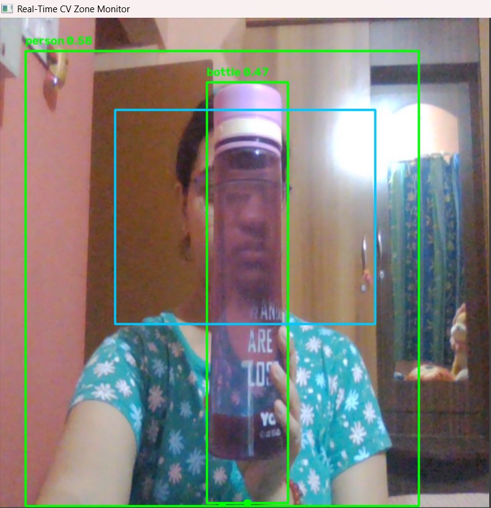
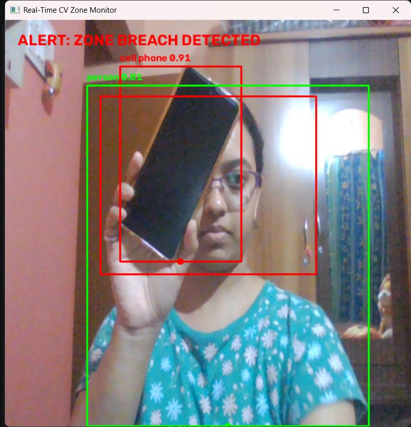
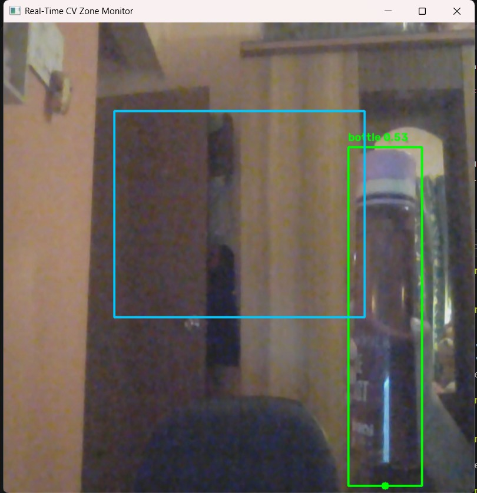
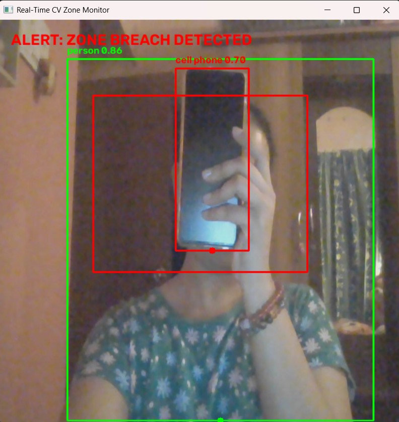

# 🚀 Real-Time Restricted Zone & Object Monitor v1.0
An intelligent, zero-cost computer vision system designed to monitor critical areas, detect restricted objects (like phones or bottles), and trigger real-time visual alerts upon boundary intrusion. This project utilizes **YOLOv8 (Nano)** for high-speed detection and **OpenCV** for image processing.

[](https://www.python.org/downloads/)
[](https://opencv.org/)
[](https://github.com/ultralytics/ultralytics)

---

## 📸 Output Showcase

Here is the system in action. The monitoring zone (polygon) changes instantly when an intrusion is detected by the model.

| Normal Operation (Safe) | Intrusion Alert! |
| :---: | :---:|
| *Light Mode: The zone is clear. Boundary is Cyan.* | *Light Mode: An object (phone) has entered the zone. Boundary and Bounding Box turn Red.* |
| ** | ** |
| *Low Light Mode: The zone is clear. Boundary is Cyan.* | *Low Light Mode: An object (phone) has entered the zone. Boundary and Bounding Box turn Red.* |
| ** | ** |

---

## ✨ Project Highlights
* **Real-Time Performance:** Optimized to run efficiently on standard CPUs, achieving ~25-30 FPS using the 'yolov8n.pt' model.
* **Dynalic Visual Alerts:** The system provides immediate visual feedback; the Region of Interest (ROI) border and the object's bounding box shift instantly from syan to read upon a breach.
* **Zero-Cost & Local:** Operates entirely offline. It requires no cloud APIs, paid subscriptions, or dedicated GPU hardware.
**Customizable ROI:** Easily define any 4-point polygonal monitoring zone using simple NumPy arrays in the configuration.

---
## 🛠️ Technical Details

The project relies on a streamlined Python technology stack for computer vision tasks.

| Component | Description |
| :--- | :--- |
| **Core AI Model** | **Ultralytics YOLOv8 (Nano)**. Chosen for its balance of speed and accuracy on edge devices. |
| **Computer Vision Library** | **OpenCV (cv2)**. Used for video capture, image manipulation, drawing overlays, and geometric tests. |
| **Language** | Python 3.9+ |
| **Intrusion Methodology** | I calculate the "bottom-center anchor point" of any detected object's bounding box and use OpenCV's `cv2.pointPolygonTest` to determine if that anchor point lies within the defined zone boundary. |

---

## 🚀 Future Modifications & Roadmap

I plan to evolve this prototype into a more robust monitoring suite. 

*   **[ ] Persistent Object Tracking:** Upgrade from standard detection (`model()`) to object tracking (`model.track()`) to assign unique IDs to objects and measure "dwell time" (how long they stay in the zone).
*   **[ ] Event Logging & Database:** Integrate local SQLite or PostgreSQL support to automatically log intrusion timestamps, object classes, and capture snapshot images of violations.
*   **[ ] Multi-Stream Support:** Refactor the script to ingest and monitor multiple IP camera RTSP streams concurrently.
*   **[ ] Headless Web Interface:** Implement a FastAPI backend to serve the annotated video feed to a web browser, allowing remote monitoring without opening the desktop terminal.

---

## 🎯 Use Cases

This lightweight monitor is highly adaptable for various security and safety scenarios:

*   **Workspace Security:** Monitoring "clean desk" environments to ensure restricted items like laptops or smartphones are not left unattended in designated zones.
*   **Industrial Safety:** Creating virtual fences around hazardous machinery to detect if unauthorized personnel enter the operational perimeter.
*   **Retail Analytics:** Monitoring high-value product displays to track customer interaction duration or detect inventory removal from a specific shelf area.

---

## ⚙️ Quick Start

1. **Clone the repository:**
   ```bash
   git clone [https://github.com/shazam-25/cv_zone_monitor.git](https://github.com/shazam-25/cv-zone-monitor.git)
   cd cv-zone-monitor
